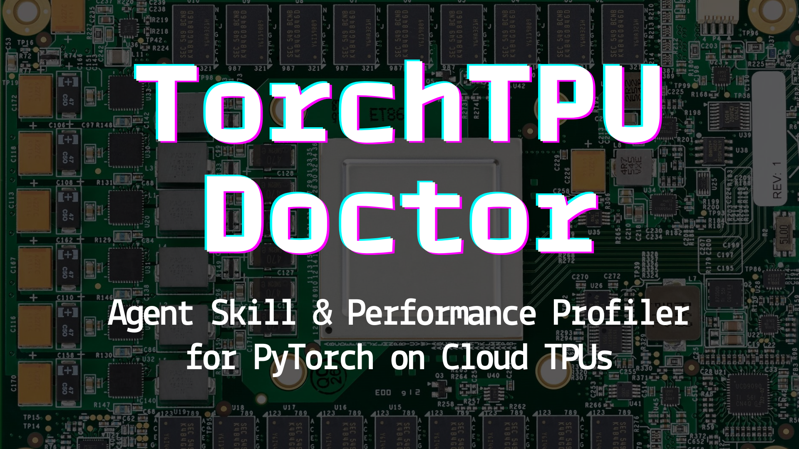
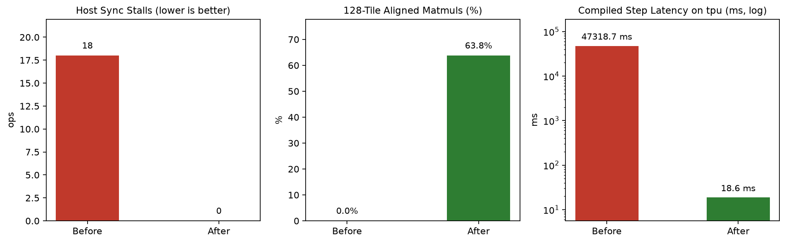

# TorchTPU Doctor: Agent Skill & Performance Profiler for PyTorch on Cloud TPUs

[](https://github.com/jigyasa-grover/TorchTPU-Doctor/actions/workflows/ci.yml)
[](https://colab.research.google.com/github/jigyasa-grover/TorchTPU-Doctor/blob/main/notebooks/torchtpu_doctor_demo.ipynb)
[](https://jigyasa-grover.github.io/TorchTPUDoctor/)
[](https://github.com/huggingface/peft/pull/4099)
[](LICENSE)

> **TL;DR:** GPU-style PyTorch and Hugging Face scripts run on `torch_tpu` without raising exceptions while quietly losing orders of magnitude in throughput. On a **Cloud TPU `v6e-1`** VM fine-tuning `Qwen/Qwen2.5-0.5B-Instruct` with `peft` LoRA, `torchtpu-doctor` cut 6-step eager runtime by **53.2x** (`70.7s` → `1.33s`) and `torch.compile(backend="tpu")` step latency from **47.3 s/step down to 18.6 ms/step** (**2,537x faster**):
> - **Stopped silent `'cpu'` fallback (`patch_hf_tpu()`):** Patched `peft` and `sentence-transformers` device helpers (`'cpu'` → `'tpu'`) so auto-detected setups and adapter loads target `tpu:0` instead of host CPU (merged upstream in **[huggingface/peft#4099](https://github.com/huggingface/peft/pull/4099)** · **[Issue #4101](https://github.com/huggingface/peft/issues/4101)**).
> - **Eliminated `18 → 0` host-device sync stalls (`scan` + `tpu_doctor()`):** Flagged hot-path `loss.item()` calls *and* caught + patched **2 hidden CPU readbacks/step** inside `transformers.masking_utils` causal-mask slicing (upstream discussion & `torch_tpu` maintainer confirmation: **[huggingface/transformers#50267](https://github.com/huggingface/transformers/pull/50267)**, **[google-pytorch/torch_tpu#6127](https://github.com/google-pytorch/torch_tpu/issues/6127)**).
> - **Prevented per-step `44–77s` XLA recompiles (`TileAlignedCollator`):** Bucketed 6 ragged `(batch, seq)` shapes into 2 `8×128` MXU-aligned shapes (`99.9%` FLOP-weighted MXU fill) and replaced in-place loop slice writes to preserve XLA buffer donation (`70.7s` → `1.33s` 6-step eager; `47.3 s/step` → `18.6 ms/step` compiled).
>
> **Full engineering write-up & `v6e-1` tracebacks → [jigyasa-grover.github.io/TorchTPUDoctor](https://jigyasa-grover.github.io/TorchTPUDoctor/)**

## Overview

[TorchTPU](https://github.com/google-pytorch/torch_tpu) is an open-source collaboration between Google and Meta's PyTorch team that introduces a native, principled PyTorch backend for Google Cloud TPUs ([PyTorch Blog](https://pytorch.org/blog/introducing-torchtpu/) · [Google Cloud Blog](https://cloud.google.com/blog/topics/ai-infrastructure/torchtpu-is-now-open-source-run-native-pytorch-on-tpus) · [Cloud TPU Docs](https://docs.cloud.google.com/tpu/docs/pytorch-on-tpu)). `torchtpu-doctor` packages four focused components to diagnose and fix silent GPU-to-TPU bottlenecks:

1. **Agent Skill ([`SKILL.md`](.agents/skills/torchtpu-doctor/SKILL.md))**: Drop-in ruleset for Antigravity and Claude Code so coding agents emit native `torch_tpu` idioms instead of legacy `torch_xla` boilerplate.
2. **Static AST Scanner (`torchtpu-doctor scan`)**: Zero-dependency linter (`TPU001`-`TPU006`) for Python files and CI pipelines.
3. **Live Dispatch Guard (`with tpu_doctor():`)**: `TorchDispatchMode` context manager that audits warmup steps for `aten::_local_scalar_dense` host syncs (including inside third-party libraries), cross-step shape drift, partial-slice storage writes, non-unit-stride views, and FLOP-weighted `8x128` MXU tile fill.
4. **Drop-in Runtime Helpers (`patch_hf_tpu`, `TileAlignedCollator`, `enable_tpu_cache`, `get_device`)**: In-memory patches for `peft`, `sentence-transformers`, and `transformers.masking_utils` on `tpu:0`, plus 128-aligned sequence/batch bucketing.

## Benchmark (`Qwen2.5-0.5B-Instruct` + PEFT LoRA on Cloud TPU `v6e-1`)

Measured on a single `v6e-1` Cloud TPU VM (`torch_tpu 0.2.0`, `PyTorch 2.15.0+cpu`, `libtpu 0.0.51`) across 6 variable-length supervised fine-tuning steps ([`examples/naive_lora_sft.py`](examples/naive_lora_sft.py) vs. [`examples/tpu_lora_sft.py`](examples/tpu_lora_sft.py), full executed outputs in [`notebooks/torchtpu_doctor_demo.ipynb`](notebooks/torchtpu_doctor_demo.ipynb)):



| Metric | Before (Naive Port) | After (`torchtpu-doctor`) |
| :--- | :--- | :--- |
| `peft.utils.other.infer_device()` | `'cpu'` | `'tpu'` |
| Unique `(batch, seq)` shapes (6 steps) | `6` (`(3, 27)` .. `(3, 141)`) | `2` (`(4, 128)`, `(4, 256)`) |
| Host sync stalls (`aten::_local_scalar_dense`) | `18` (`3` / step) | `0` |
| Partial-slice storage writes | `6` | `0` |
| 128-tile aligned matmuls | `0 / 1590 (0%)` | `1014 / 1590 (64%, 99.9% FLOP-weighted MXU fill)` |
| Eager 6-step audit wall time | `70,668 ms` | `1,329 ms` (**53.2x faster**) |
| `torch.compile(backend="tpu")` step time | `47,318.7 ms/step` | `18.6 ms/step` (**2,537x faster**) |

## Upstream Ecosystem Contributions

Bottlenecks uncovered by `torchtpu-doctor` on Cloud TPU `v6e-1` and contributed upstream:

| Upstream Repository | PR / Issue | Status & Impact |
| :--- | :--- | :--- |
| **`huggingface/peft`** | **[PR #4099](https://github.com/huggingface/peft/pull/4099)** · **[Issue #4101](https://github.com/huggingface/peft/issues/4101)** | **Merged:** Support PyTorch `torch.accelerator` backends (`torch_tpu`) in `infer_device()` (`'cpu'` → `'tpu'` across `load_adapter`, `save_and_load`, `hotswap`, and LoRA helpers) |
| **`google-pytorch/torch_tpu`** | **[Issue #6127](https://github.com/google-pytorch/torch_tpu/issues/6127)** | **Confirmed:** End-to-end `v6e-1` dispatcher tracebacks & ecosystem report validated by `torch_tpu` maintainers |
| **`huggingface/transformers`** | **[PR #50267](https://github.com/huggingface/transformers/pull/50267)** | Eager `_ignore_causal_mask_sdpa` TPU sync report (`456.5 ms/step` → `221.5 ms/step` with opt-in `patch_hf_tpu()`; `torch.compile` skips upstream via `is_tracing`) |

## Installation

```bash
pip install git+https://github.com/jigyasa-grover/TorchTPU-Doctor.git
```

## Quickstart

### CLI

```text
$ torchtpu-doctor scan examples/naive_lora_sft.py
naive_lora_sft.py:12: TPU001 `peft.utils.other.infer_device()` omits 'tpu' and falls back to 'cpu' -> call `patch_hf_tpu()` at startup or use `get_device()`
naive_lora_sft.py:43: TPU003 `padding=True` without `pad_to_multiple_of=128` causes per-batch XLA recompiles -> pass `pad_to_multiple_of=128` or use `TileAlignedCollator`
naive_lora_sft.py:77: TPU004 in-place slice write inside loop/forward can break XLA buffer donation -> prefer out-of-place `torch.where` / `torch.cat` under `torch.compile(backend='tpu')`
naive_lora_sft.py:78: TPU002 `.item()` in hot path flushes TorchTPU deferred fusion queue -> accumulate tensors on device and read `.item()` only on log steps

Found 4 potential TorchTPU issue(s).
```

Pass `--strict` to return exit code `1` in CI, `--json` for machine-readable output, or `# noqa: TPU002` to suppress an intentional line. Run `torchtpu-doctor demo` for a self-contained dispatch check on any CPU/GPU machine.

### Python API

```python
import torch
import torchtpu_doctor as ttd

ttd.enable_tpu_cache("/tmp/torchtpu_cache")
ttd.patch_hf_tpu()
device = ttd.get_device()

collator = ttd.TileAlignedCollator(
    pad_to_multiple_of=128,
    buckets=(128, 256, 512, 1024),
    pad_token_id=tokenizer.pad_token_id,
    pad_batch_to_multiple_of=4,
)

# Audit 2-6 eager warmup steps before torch.compile(model, backend="tpu", dynamic=False)
with ttd.tpu_doctor("warmup") as doc:
    for step, batch in zip(range(4), loader):
        train_step(model, batch)
        doc.step()
print(doc.result.format_text())
```

## Static Rules (`TPU001`-`TPU006`)

| Code | Detects | Fix |
| :--- | :--- | :--- |
| `TPU001` | `.cuda()`, `'cuda'`/`'nccl'` literals, internal `torch.tpu.is_available()`, unpatched `peft`/`sentence-transformers` device helpers | Use `get_device()` / `torch.accelerator.*` and call `patch_hf_tpu()` |
| `TPU002` | `.item()`, `.cpu()`, `.numpy()`, `.tolist()`, or `synchronize()` inside loops / `forward()` | Accumulate detached scalars on device; read `.item()` on log intervals |
| `TPU003` | `padding=True` without `pad_to_multiple_of=128`; hot-path `nonzero()` / `unique()` / `masked_select()` | Use `TileAlignedCollator` (`pad_to_multiple_of=128`) and fixed-shape `torch.where` |
| `TPU004` | In-place slice assignment (`buf[i:i+1] = x`) inside loops / `forward()` | Use out-of-place ops under `torch.compile(backend="tpu")` to preserve XLA buffer donation |
| `TPU005` | `torch.float64` / `.double()` casts and manual `.as_strided()` views | Use `bfloat16` or `float32` (`torch.tpu.Precision.HIGHEST` if needed) and unit minor strides |
| `TPU006` | Legacy `torch_xla` imports (`xm.xla_device()`, `xm.mark_step()`) | Migrate to native `device="tpu"` and `torch.compile(model, backend="tpu", dynamic=False)` |

## Examples, Notebook & Technical Write-Up

- **[Technical Blog Post](https://jigyasa-grover.github.io/TorchTPUDoctor/)**: Deep dive covering the five `torch_tpu` bottlenecks, XLA buffer donation, and the 2-sync-per-step `transformers.masking_utils` readback caught on `v6e-1`.
- **[`notebooks/torchtpu_doctor_demo.ipynb`](notebooks/torchtpu_doctor_demo.ipynb)**: Executed end-to-end Cloud TPU `v6e-1` benchmark notebook (`Qwen2.5-0.5B-Instruct` + `peft` LoRA).
- **[`examples/naive_lora_sft.py`](examples/naive_lora_sft.py)** / **[`examples/tpu_lora_sft.py`](examples/tpu_lora_sft.py)**: Standalone GPU-style baseline vs. TPU-aligned fine-tuning script.
- **[`.agents/skills/torchtpu-doctor/SKILL.md`](.agents/skills/torchtpu-doctor/SKILL.md)**: Drop-in skill file for Antigravity (`.agents/skills/`) and Claude Code (`.claude/skills/`).

## Development

```bash
python3 -m venv .venv
source .venv/bin/activate
pip install -e ".[dev]"
pytest -v
```

## Acknowledgments

Huge thanks to Google, Google Cloud, and the Google ML Developer Programs & Cloud TPU teams for organizing `#TorchTPUSprint` and generously providing the Cloud TPU access and compute resources for these benchmarks. Google Cloud credits are provided for this project✨

`#BuildWithAI` `#BuildWithTPU` `#TorchTPU` `#TorchTPUSprint` `#PyTorch` `#GoogleCloud`

## License

Apache-2.0. See [LICENSE](LICENSE).
